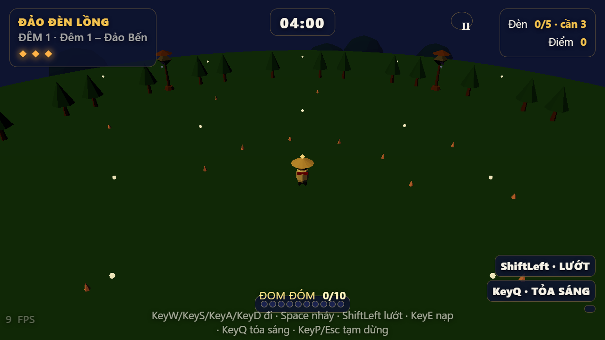

# Đảo Đèn Lồng

Mây collects fireflies, lights lanterns and keeps enough of them burning until dawn across three islands. The game runs through a loopback Node server. **[v1.0.0 is published as a Pre-release with documented exceptions](https://github.com/Dunnguyn/K5-L3A-DAY12-NguyenThiThuyDung-2A202603552-AI-SDLC-Dao-Den-Long/releases/tag/v1.0.0).** The Soak RSS requirement remains FAIL; the full Ticket-04 Definition of Done is not met.



[Watch the 124-second demo](docs/demo/demo.mp4). It shows live Night 1 input, labeled historical WS3 captures, live test/headless/benchmark/soak commands and the RSS gate failure. The [Release page](https://github.com/Dunnguyn/K5-L3A-DAY12-NguyenThiThuyDung-2A202603552-AI-SDLC-Dao-Den-Long/releases/tag/v1.0.0) also hosts the playable ZIP and demo.

## Requirements and play

Node.js 24.x and npm are required. The game uses Three.js, Vite and a shared JavaScript game core. From a clean source copy:

```sh
npm ci
npm run build
npm run start
```

Open `http://127.0.0.1:4173`. The server binds to `127.0.0.1` only. Installation needs the npm registry; gameplay after installation does not need a cloud service. The distribution ZIP includes a built site and starts with `node scripts/start.mjs` after extraction, without npm installation.

## Controls and accessibility

Default keys: W/A/S/D move, Space jump, Shift dash, E interact, Q pulse and P or Escape pause. Drag the mouse to rotate the camera and use the wheel to zoom. All nine keyboard actions can be remapped in Settings, with conflict detection and reset. Settings persist after reload. Options include distinguishable colors, reduced motion and 1.25× large text. Visible warnings cover Shade spawn, wind, the last ten seconds and low lantern fuel.

Each Night lasts 240/270/300 seconds. At dawn at least 3/5, 4/6 or 5/7 lanterns must still be lit. Fireflies light, relight and refuel lanterns; Bóng Mực can drain fuel. The bag capacity grows after successful ignitions. Night scores from wins contribute to the campaign total.

## Leaderboard

After a loss or the final dawn, submit a name of 3–12 ASCII letters, digits or underscores. The menu displays the ten best scores. The local server writes one JSON file under the user's data directory; closing and reopening the server preserves it. Set `DAO_DATA_DIR` to select an isolated profile. Export the same dataset:

```sh
node scripts/headless.mjs --export-leaderboard out.json
```

Local clients can alter submitted browser data; this is a local leaderboard, not a tamper proof online service.

## Verification and automation

```sh
npm test
npm run test:independent
npm run verify
npm run test:browser
```

Headless example: `node scripts/headless.mjs --night 1 path/to/scenario.json`. The internal `game.contract.json` manifest is version **1.3**; the official v1.0 base schema has not been verified. Render benchmark: `node scripts/bench-render.mjs --seed 42 --duration 30 --out bench.json`. Same process soak: `node scripts/soak.mjs --seed 7 --nights 10 --out soak.json`. The benchmark needs Playwright Chromium and a graphical environment; `npx playwright install chromium` may be needed after `npm ci`.

## Release status and limitations

The local render benchmark passed its thresholds, but the ten Night soak **fails** its RSS growth limit: the final-gate clean run measured 35.30 → 46.50 MiB, versus a 42.36 MiB ceiling. Four earlier clean processes also failed. The project owner accepted this exception for publication; it is not a test pass. See the [Phase 4 final report](docs/proof/phase-4/PHASE4_FINAL_REPORT.md) and [Soak evidence](docs/proof/phase-4/soak-remediation/round-2/soak-retest.json).

Official contract v1.0 compliance, real GPU grading performance, macOS, manual audio listening and independent Phase 4 QA are not verified. Phase 1–3 tags and evidence remain historical. Original code is licensed under [MIT](LICENSE); the lab premise and characters are outside that code grant. See [credits](CREDITS.md), [changelog](CHANGELOG.md) and [retrospective](docs/notes/PHASE4_RETROSPECTIVE.md).

## Sáng tạo của tôi

The game uses project-authored procedural island and lantern visuals plus synthesized Web Audio rather than downloaded game art or music. These presentation choices leave the shared gameplay rules and headless output unchanged. See the [gameplay screenshot](docs/proof/phase-4/ws3/screenshots/gameplay-hud.png), [renderer](src/browser/renderer.js) and [audio implementation](src/browser/audio.js). No additional gameplay mechanic is claimed as a creative extra.
