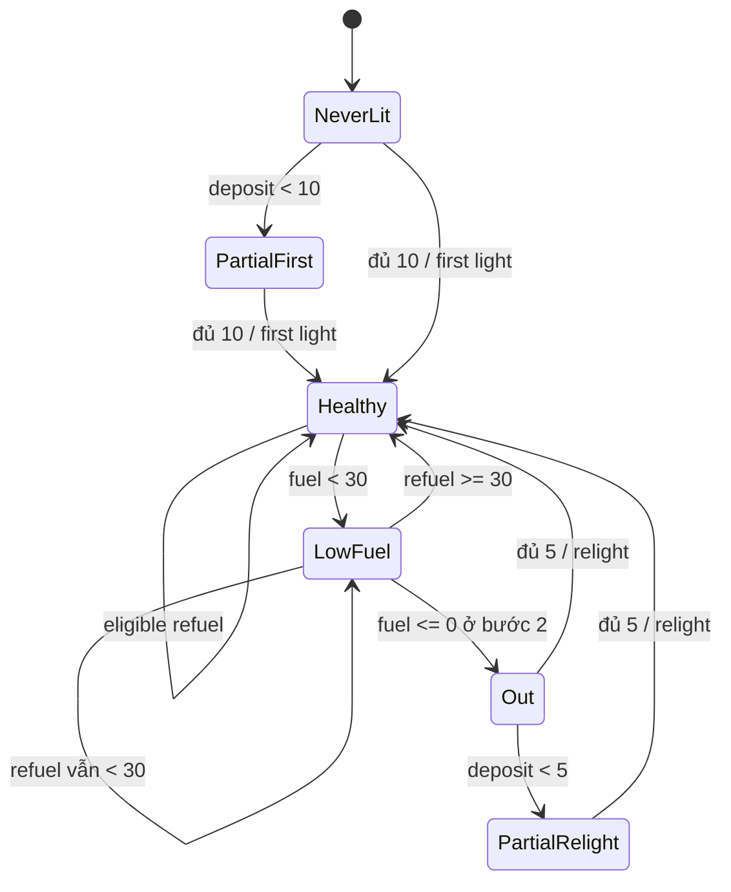
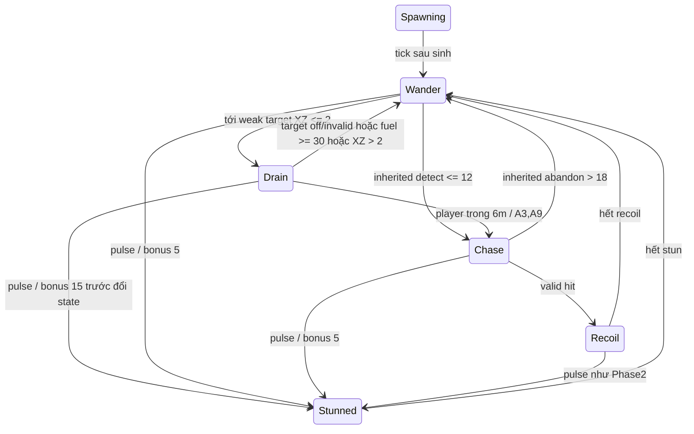
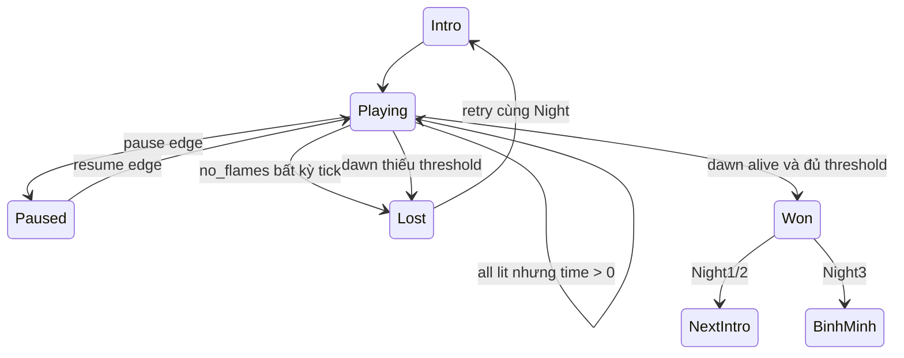

# ADR — Phase 3 Lantern fuel and dawn survival

Status: **APPROVED for Core/Headless implementation; browser rendering deferred**, 2026-11-21. Source: Ticket-03 §§1–7; Ticket-02 pipeline/unchanged rules. Không có quyết định trong ADR được coi là bổ sung chính thức vào Ticket. Chủ dự án đã duyệt Change Analysis và A1–A9 trong yêu cầu Core & Headless Implementation Approved.

## Model và arithmetic

Business state dựa trên `lit`, fuel và `ever_lit`; không tạo sáu enum contract mới. `partial`, `low-fuel`, `out`, `relit` là derived state/transition, không thay `lit` Boolean.

| Business/render state | Điều kiện | Deposit/action |
|---|---|---|
| Never-lit/unlit | !lit,!ever_lit,progress=0,fuel0 | Cost10, nạp dần |
| Partial-first | !lit,!ever_lit,0<progress<10 | Chỉ phần còn thiếu |
| Lit/healthy | lit,fuel≥30 | Refuel nếu fuel<100; safe active |
| Low-fuel | lit,0<fuel<30 | Refuel; no safe; blink1Hz |
| Out | !lit,ever_lit,progress=0,fuel0 | Cost5 để relight |
| Partial-relight | !lit,ever_lit,0<progress<5 | Nạp dần cho tới5 |
| Relit | Transition off→lit khi ever_lit đã true | fuel100,relit_count++,successful_lights++ rồi trở thành healthy |

Đề xuất giữ `progress` làm tên nội bộ/snapshot v1.1; business deposited tương ứng progress. Ticket-03 chỉ yêu cầu thêm fields, không công bố rename progress. Không thêm snapshot `deposited` hoặc enum rendering vào contract khi chưa xác nhận base.

Representation đề xuất **F60 integer**, 60 units cho1fuel: max6000, threshold1800, decay1/tick, drain5/tick/Shade, refuel600/mote. Không cộng/trừ 1/60 floating mỗi frame. Bắt đầu lit tại bước5: F60=6000, không bị decay lần nữa trong tick đó; lần giảm đầu ở bước2 tick kế. Đèn out giữ0, không âm. Round chỉ khi xuất snapshot: numeric round(F60/6)/10; JSON có thể viết100 thay vì100.0 — cần chốt lexical requirement ở A8. Dawn floor dùng floor(F60/60), không floor số đã round.

Ví dụ oracle **chưa chạy**: pre-lit100 qua1tick còn5999/60≈99.9833, snapshot100.0 nhưng dawn floor99. Fuel ngay dưới30 có F60=1799, snapshot30.0 nhưng safe=false. Mô hình không suy logic từ rendered/serialized fuel. Scenario arbitrary decimals có thể không nằm trên lattice1/60: xem A4, không âm thầm làm tròn qua ngưỡng30.

Refuel theo raw units: `used=min(bag,ceil((6000-F60)/600))`, `F60=min(6000,F60+600*used)`, score+=5*used, bag−=used. Full tại bước5 bị loại trước xếp hạng. Chọn một eligible lamp theo khoảng cách3D/radius2 và ID cũ. Off dùng min(bag,cost−progress), cost=ever_lit?5:10. Hoàn tất: capture ever_lit trước transition, first+100 hoặc relight+40; mọi mote vừa dùng+5; set lit/fuel/ever_lit, update counters một lần. Refuel không đổi successful_lights/relit_count. Partial không tăng capacity. Out đặt progress0, không xóa ever_lit/relit_count.

## Pipeline 12 bước giữ nguyên

| Bước | Phase3 xử lý / vị trí thay đổi |
|---|---|
| 1 | Input và rising edges; pause trước mọi mutation simulation. Paused vẫn tăng tick, không tăng sim_tick/fuel/counter |
| 2 | Time/timers như cũ; tính eligible drainers từ state/target đầu tick, aggregate decay+drain theo lamp; clamp0. Phát sampled drain theo A2, sau đó tắt từng lamp≤0 ngay sau bước2, emit out một lần, progress0. Không chuyển phần drain sang bước8 |
| 3 | Movement/jump/dash/pad/wind/fall giữ tuning. Death-by-fall cần luôn có terminal evaluation/event ở bước11, không bỏ game_over do short-circuit cũ |
| 4 | Pickups theo capacity **trước** lần lighting bước5; charm như Phase2 |
| 5 | Một interaction: select eligible, deposit/first/relight/refuel, consume/score/counters. Không decay lại fuel vừa tạo |
| 6 | Safe active iff lit và raw fuel≥30; eviction≤30ticks/no contact. Áp dụng cùng predicate cho AI wall và bảo vệ player ở bước9 |
| 7 | Pulse3D như cũ. Capture state mỗi Shade ngay trước hit: drain→15 tổng, khác→5; sau đó stun120/push15 như cũ |
| 8 | Shade AI/guard transitions/targeting; new drain chỉ bắt đầu mất fuel ở bước2 tick sau. Drifter FSM không thêm drain. A3 chốt guards đồng thời |
| 9 | Drifter steal trước Shade contact, at most1flame hit. Capacity mới không đổi theft min(3,bag), drop floor(bag/2) |
| 10 | Spawn schedules như Phase2. New entities không retroactively drain/pickup/hit trong tick sinh |
| 11 | no_flames trước; nếu time>0 luôn playing dù all-lit; time=0 alive đạtceil(.6N)→won/dawn_survived, còn lại lost/dawn. Score bonus chỉ một lần khi win |
| 12 | Snapshot theo cadence hiện tại; thêm fields được công bố; không phát sinh physics vì render FPS |

Step2 latches: đề xuất lấy danh sách state=drain có valid target lit-low và XZ≤2 **trước** aggregate. Không chạy player proximity/chase AI sớm ở bước2. `F'=max(0,F−1−5*k)` không phụ thuộc thứ tự cập nhật Shades. Nếu fuel đủ ít, một out event/lamp, không emit lặp theo số Shades. Pulse/refuel/player approach ở các bước sau không hoàn tác drain đã áp dụng trong tick. Nếu lamp out ở bước2 rồi relight bước5 trên tick dawn, bước11 đếm trạng thái **sau relight**.

Safe state: `active=lit && F60>=1800`; inactive không eviction/không chặn/không miễn contact. Refill tới đúng30 kích hoạt lại ngay bước6. Không giữ zone chỉ vì ever_lit. Predicate dùng chung trong safe(), ai() và contacts(), không ảnh hưởng Drifter. Overlapping active zones giữ logic radius6; weak target bên trong active zone khác không được xuyên qua zone đó.

| Safe-zone state | Transition | Observable effect |
|---|---|---|
| Inactive | lit và raw fuel đạt ít nhất 30 | Active ở bước 6; bắt đầu eviction theo luật kế thừa |
| Active | raw fuel giảm dưới 30 hoặc lamp out | Inactive; mất bảo vệ, không giữ hiệu lực vì ever_lit |
| Active | raw fuel vẫn từ 30 trở lên | Giữ bảo vệ; không khởi động lại eviction timer mỗi frame |
| Inactive | partial deposit chưa thắp đủ | Vẫn inactive |

## Shade và night state machines

Wander target không phải enum mới: ưu tiên nearest lit rawFuel<30, tieID; không có thì nearest off; không có target thì fallback nội bộ theo A6. Chase giữ target Mây, không bị weak lamp retarget. Detect12/abandon18 không tự thay bằng6;6 chỉ là drain exit. Rule pulse/stun/recoil/safe evacuation không được làm state drain còn hút trong ticks stunned.

Drain radius2 được Ticket ghi rõ là **XZ**, không tự thêm giới hạn Y như contact damage. Interaction của Mây vẫn dùng metric3D/radius2 hiện có. NPC giữ collision của map; “chọn mục tiêu gần nhất” không tự cấp quyền xuyên vách hoặc yêu cầu A* mới. Cần test target khác tầng và target bị chặn, không sửa map để tạo đường tắt.

Không yêu cầu giữ60% liên tục từ đầu đêm; chỉ sample cuối tick dawn. Không win early. Capacity reset `successful_lights=0,capacity10` mỗi night/retry; settings/won-night totals giữ luật Phase2. Scenario prelit không tự cộng successful_lights. Capacity = min(20,10+2*successful_lights), counter vẫn đếm relights quá lần5, không clamp counter theo capacity.

Score oracle: deposit5,first100,relight40; pulse pre-hit drain15 **tổng**, không20. Dawn win: Σlit(50+floor(rawFuel))+50*flames; không cộng cho lamp out và không có bonus khi lost. Time bonus bỏ hoàn toàn. Campaign cộng night score khi won một lần; retry không cộng duplicate. Ví dụ planned:5 pre-lit100 ở dawn tick còn5999units mỗi lamp → bonus5*(50+99)+150=895; đèn mới thắp đúng bước5 tick dawn còn100 → bonus lamp đó150.

## Approved decision register (original proposals retained for traceability)

| ID | Chưa đủ chi tiết chính thức | Đề xuất cụ thể | Ảnh hưởng / approval |
|---|---|---|---|
| A1 | refuel.amount là motes hay fuel thực thêm? | amount=used motes; fuel là final rounded fuel. Ví dụ99.9+1mote→amount1,fuel100,score5, không amount0.1/10 | Contract oracle blocker |
| A2 | fuel_drain mỗi60tick tính global hay mỗi actor; reset; event khi out | Per-Shade counter60 **eligible sim ticks**, reset khi exit/re-enter; pause freeze. Enter drain ở AI tickk→first eventk+60. Aggregate trước; các events cùng lamp ghi cùng final fuel; ordered lampID/shadeID; events due trước lantern_out | Contract/event cadence blocker |
| A3 | Guards cùng tick; effect step2→step8; phản ứng safe + pulse | Step2 dùng prior drain states; guards AI ở8. Safe6 evicts/marks contact suppression, không tự chạy AI sớm. Pulse7 đọc pre-hit state (có thể vẫn drain sau refuel); AI8 clear invalid drain trước eviction early-return, trừ khi pulse đã chuyển stunned. Invalid target/healthy/out/>2 ưu tiên wander rồi mới proximity chase; tối đa một guarded transition/AI stage | State/score/ordering blocker |
| A4 | Scenario fuel decimal precision + inconsistent tuples | F60 integer: chỉ chấp nhận fuel biểu diễn được bằng1/60 (tolerance chuyển đổi phải công bố), không âm thầm round29.99 thành30. lit=true missingfuel→100 là **chính thức**; đề xuất ever_lit mặc định=lit; off thiếufuel→0,relit_count0; reject lit=true fuel0,off fuel>0,lit=true ever_lit=false. Phương án khác: exact decimal rational để hỗ trợ arbitrary finitefuel | Numeric/default blocker; giới hạn scenario đề xuất chưa phải Ticket |
| A5 | Scenario lamp envelope/merge, target references | Internal draft: `scenario.lanterns` override theo canonicalID, giữ đủ5/6/7 lamps; omitted/defaults giữ default,[] không xóa map; reject duplicate/unknownID. target_lantern_id nullable/optional ngoài drain; drain cần ID valid, cho phép player gần để test pre-AI stage. Không rename progress/deposited | Internal schema blocker; baseofficial còn thiếu |
| A6 | Khi wander không còn weak/off lamp, tie ID, metric chưa ghi | Giữ deterministic wander góc cũ khi không target; không RNG mới. Weak/off chọn distanceXZ và stable ID cũ. Giữ player detect12 ưu tiên trước chọn lamp; drain player6 dùngXZ | Gameplay policy cần duyệt |
| A7 | Accessibility default/trục xẹp/phạm vi mode | PersistedBoolean defaultfalse, extend settings keyv1 giữvolume/sensitivity. Cyan#00B3FF cho edge+eyes khi bật; normal edge+eyes#7A3CFF theo wording mới. Off paper-cage scaleY.8+torn silhouette **mọi mode**; không scale pole/collider. Lowfuel blink1Hz mọi mode; warning white+⚠ khi bật | Visual/input default cần duyệt |
| A8 | game_over base absent; progress field; numeric lexicalformat | Internal additive event `game_over {reason}` một lần bước11, chỉknownreasonenum; không bịa score/timestamp/envelope fields. Giữ local internal-draft-1 wrapper và progress; snapshot fuel rounded numeric1decimal, không yêu cầu textual100.0 khi JSON.stringify viết100. Legacy v1.1/new semantics không chạy ngầm hai mode | Contract/base boundary cần duyệt |
| A9 | 6m drain chase tham chiếu Shade hay lamp; bonus15 trong real play | Giữ6m tớiShade, pulse5 như Ticket02; chấp nhận ordinary approach thường bị chase trước pulse. Test15 bằng valid initial drain fixture và same-tick paths, không tự đổi6/5 để ép browser bonus. Nếu designer muốn bonus dễ đạt, cần xác nhận tham chiếu6m/timing hoặc sửa requirement chính thức | Product-design tension cần duyệt |

Death-by-fall integration proposal thuộc A3/A8: mọi đường terminal phải đi qua một finalizer/event bước11 cùng tick; không được nhặt/nạp sau flames0. Việc world-only AI/spawn còn chạy sau fatal movement cần chốt cùng quy tắc này; không lén thay thứ tự12bước hoặc phát game_over ởtick sau.

Determinism: integer arithmetic sau normalization đã duyệt; fixed60Hz; stable ID order; seeded RNG hiện có; no DOM/clock trong Core; drain counters chỉ sim_tick; immutable pre-step2 contributor list; snapshot rounding không feedback vào Core. Test replay cùng seed/actions/scenario byte/semantic output theo internal adapter hiện có, không tự tuyên bố RNG/schema chính thức.

Consequences: model/tuning có breaking changes; test fixtures lit=true thiếufuel cần chuẩn hóa; E2E phải nạp lại và đợi dawn; old21.600sim-tick benchmark phải phân biệt18.000active ticks mới; rendering bars/outline cần reuse/instancing vì Phase2 đã có performance PARTIAL. Các phương án A1–A9 đã được chủ dự án duyệt; Core/Headless đã chạy verification, browser vẫn deferred.

## Core implementation resolution — 2026-11-21

A1 uses mote count and numeric one-decimal final fuel. A2 counts 60 consecutive eligible simulation ticks per Shade, resets on exit/target change, freezes on pause, and reports stable lamp-ID/Shade-ID order after aggregation and before out. A3 preserves step order: step-2 contributors are latched; safe zones suppress movement/contact; pulse stun has state-transition priority. Fatal fall still completes world-only stages 6/8/10 and finalizes at 11, while player actions 4/5/7/9 are guarded after Flames reach zero.

A4 accepts finite fuel on the 1/60 lattice with conversion tolerance 1e-8 of one internal unit; 29.99 is rejected, never rounded across 30. A5 merges canonical lamp IDs without geometry overrides; missing ever_lit derives from lit. A6 retains wander detection 12/abandon 18; the new drain-to-chase range alone is 6m XZ. A8 retains the local internal-draft-1 wrapper, progress and numeric JSON fuel (100 is numerically equivalent to 100.0), emits game_over with reason once, and does not invent the v1.0 base. A9 keeps pulse range 5m 3D. A7 is approved design only; no browser visuals/settings implemented here.

No conflict requiring a Ticket-03 change was found. Decisions here are approved implementation policies, not edits to official requirements. OFFICIAL CONTRACT COMPLIANCE remains NOT VERIFIED.

## D1 — Release safe-boundary numerical robustness

Root cause: a projected point can land one ULP inside radius6 in one runtime; safe stage repeatedly re-arms evacuation, changing drain/events/score. Use direct radial normalization via sqrt and a squared-distance16*Number.EPSILON*r² roundoff guard (about1.1e-14m radially), not a gameplay radius/tuning change. Regression tests cover both adjacent representable positions,29countdown ticks and genuine interior eviction. Full per-tick same-input runtime comparison confirms gameplay parity. Two Night3 map-generated mote coordinates retain<=7.11e-15m representation differences only; official unspecified coordinate schema remains unverified. This corrects a bug within the approved release-remediation scope and adds no business rule.
